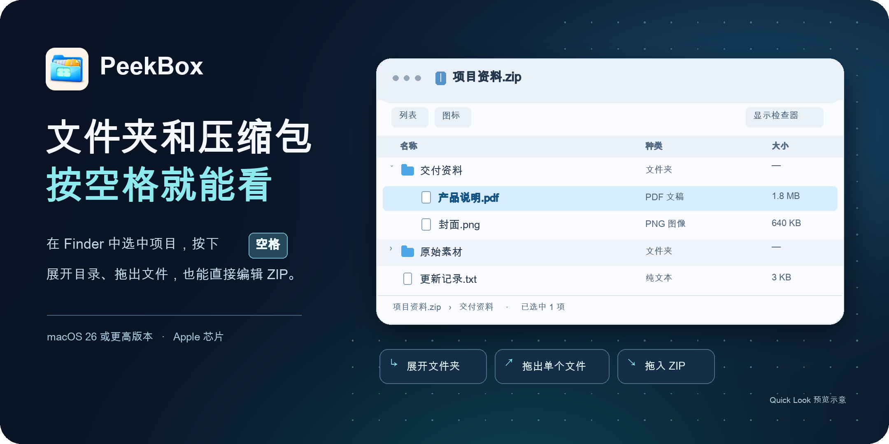

[简体中文](README.md) · **English**



# PeekBox

PeekBox is a Quick Look tool for Apple silicon Macs. Select a folder or an archive in Finder and press Space to expand its contents, inspect entries, and work with files. When you only need a few files from an archive, select them and drag them where you want them.

[Download](https://github.com/davie-01/Peekbox/releases/latest) · [Build from source](#build-from-source) · [Design (Chinese)](docs/DESIGN.md) · [Third-party licenses (Chinese)](THIRD-PARTY-LICENSES.md)

## What it does

| Task | How |
| --- | --- |
| Browse folders | Expand subfolders and the archives inside them, switch between list, icon and column views, and see size, kind and dates. |
| Browse archives | View ZIP, 7z, RAR, TAR, tar.gz, tar.bz2 and tar.xz, plus gzip, bzip2 and xz files that macOS recognizes. |
| Browse disk images | View the files in DMG, ISO, CDR and Toast images without mounting them. HFS+, APFS, FAT, UDF, ISO 9660 and other file systems are supported, as are DMGs in every compression format; apps inside an image show their own icon and total size, as in Finder. |
| Install an app from a DMG | In the preview, drag the app onto the image's Applications alias to copy it into the Applications folder. If an item with the same name exists, choose Replace (the old version goes to the Trash), Skip or Keep Both. |
| Extract only what you need | Select one or more entries in the preview and drag them to a Finder folder or the desktop. Enter the password when asked for encrypted content. |
| Edit ZIP archives | Drag files or folders from Finder into the root or a subfolder of a ZIP, create folders, or rename and delete entries. Follow the prompt when a name already exists. |
| Open and inspect files | Open, copy, copy the path, show info or reveal in Finder from the toolbar or the context menu. Available actions depend on the item and on permissions. The inspector shows the contents of supported file types. |

Files dragged out of, opened from or copied out of an archive or disk image keep the original file's download quarantine attribute, as with Archive Utility and mounted images, so a downloaded app is still checked by macOS the first time it opens. Encrypted DMGs cannot be previewed yet; partitions that cannot be browsed yet, such as exFAT, are listed as disk image files that you can drag out and mount in Finder.

ZIP editing works on regular, single-volume, writable ZIP archives on an internal disk. Network volumes, external volumes, iCloud files and archives with signatures are read-only. Encrypted ZIP archives do not accept new files or folders, but their entries can be renamed and deleted. 7z, RAR, TAR and the other formats can be browsed and extracted.

Keep all volumes of a multi-volume archive in the same folder:

| Volume format | Entry volume | How to open |
| --- | --- | --- |
| Split ZIP (`.zip` + `.z01` …) | `.zip` | Select the entry volume and press Space, or expand it in a preview of the enclosing folder |
| Multi-volume RAR (`.part01.rar` …) | `.part01.rar` | Same as above |
| Numbered volumes such as 7z (`.001` …) | `.001` | Only from a preview of the enclosing folder (macOS does not recognize `.001` as an archive) |

Encrypted multi-volume archives are supported too; enter the password when asked.

## Installation

**Requirements**: an Apple silicon Mac (M series, arm64) running macOS 26.0 or later.

1. Open [GitHub Releases](https://github.com/davie-01/Peekbox/releases/latest) and download `PeekBox-<version>.zip` from Assets.
2. Unzip it, drag `PeekBox.app` to Applications, and open it once.
3. On the PeekBox home page, check that Folder Preview, Archive Preview and Background Service all show Enabled. The background service registers itself the first time you open the app, and macOS shows a "Background Items Added" notification. It handles opening, copying, extracting and ZIP editing, and only runs when needed. If an extension is not enabled, use the button next to it to open System Settings → General → Login Items & Extensions → Quick Look and turn it on.
4. Go back to Finder, select a folder or an archive, and press Space.
5. If the "Other Preview Extensions" section on the home page lists another app (such as Folder Preview Pro), that app also previews the same kinds of files and macOS may pick it instead of PeekBox. Turn it off under Quick Look.

### "Apple could not verify" warning

The current release is not notarized by Apple. After confirming that the download came from this project's GitHub Releases, try to open the app once, then go to System Settings → Privacy & Security, click Open Anyway in the Security section, confirm, and open the app again. [Apple's instructions](https://support.apple.com/102445)

If that option does not appear and you have confirmed where the download came from, you can remove the download quarantine attribute from `PeekBox.app` only. The commands below assume the app is already in Applications.

```bash
# Remove the download quarantine attribute from this app bundle and its contents only.
xattr -dr com.apple.quarantine "/Applications/PeekBox.app"

# Open the app again to start first-run setup.
open "/Applications/PeekBox.app"
```

Removing the quarantine attribute does not notarize the app, and it does not fix a damaged bundle or an invalid code signature. If macOS says the app will damage your computer, check the download source and the release files again.

## Usage

1. **Preview.** Select a folder, an archive or a disk image in Finder and press Space. Click the disclosure triangle to expand a subfolder, or double-click a folder to go into it.
2. **Extract.** Drag the selected entries out of an archive preview to the desktop or a Finder folder. If the app asks for a password, unlock first and then drag again.
3. **Edit a ZIP.** Drag files from Finder onto an empty area of the ZIP preview or onto a target folder. Right-click to see whether you can create a folder, rename or delete at the selected location. A progress window appears while writing, and you can keep browsing the preview; closing the preview does not stop the write, and the contents refresh when you open it again. By default, the version before a rename, delete or replace is moved to the Trash as "xxx (before edit).zip", where you can use Put Back.
4. **Customize.** Use the preview toolbar to switch views or open the inspector. In the app you can manage columns, icon size, hidden files, the archive size limit and the temporary cache.

Browsing and extraction happen on your Mac, and PeekBox collects no data. Sparkle contacts the update feed on GitHub only when you click Check for Updates in the app; when a new version is available, the prompt lists what changed.

## Build from source

You need an Apple silicon Mac, the full Xcode (with the macOS 26 SDK or later and Icon Composer asset compilation), Git, CMake and XcodeGen. The example below installs the build tools with Homebrew.

```bash
# Install the project generator and the build tool for libzip.
brew install xcodegen cmake

# Clone the project and enter the source directory.
git clone https://github.com/davie-01/Peekbox.git
cd Peekbox

# Download pinned third-party sources and build arm64 XCFrameworks.
./Scripts/build-libzip.sh
./Scripts/build-xadmaster.sh
./Scripts/build-7zip.sh

# Generate the Xcode project from project.yml and fix the file type of AppIcon.icon.
./Scripts/generate-project.sh

# Open the generated project and review the signing settings of each target in Xcode.
open PeekBox.xcodeproj
```

The repository is set up for the maintainer's development team. Before building with your own certificate, set your team and signing identity in `project.yml`, and update the App Group, Mach service name, LaunchAgent and `PeekShared.teamID` of every target to the same team prefix. Otherwise the app may build, but the Quick Look extensions cannot reach the background service. See [Signing and IPC](docs/DESIGN.md#签名与进程间通信) for the exact locations.

Once signing is configured, you can build and install a Debug build with the repository script. The script replaces `/Applications/PeekBox.app` and refreshes PeekBox's extension registration, so back up any copy already there.

```bash
# Build a Debug build, install it to Applications, and refresh the Quick Look extension registration.
./Scripts/install.sh

# After the third-party frameworks are built, run the PeekCore tests.
swift test --package-path Packages/PeekCore
```

Some format tests need `7zz` (`brew install sevenzip`); they are skipped automatically when it is not found. Installing a release build does not require Xcode, XcodeGen, CMake or `7zz`.

## Feedback and license

When reporting a problem, include your macOS version, PeekBox version, the file format, steps to reproduce, and whether you previewed the item directly from Finder or expanded it inside a folder preview. For private or encrypted content, a sample with the sensitive data removed helps. [Open an issue](https://github.com/davie-01/Peekbox/issues)

PeekBox's own code is licensed under the [GNU General Public License v3](LICENSE) (GPL-3.0-only). Third-party components are covered by their own licenses; see [Third-party licenses](THIRD-PARTY-LICENSES.md). The license texts also ship inside the app: open About in PeekBox and click Show License Files.
