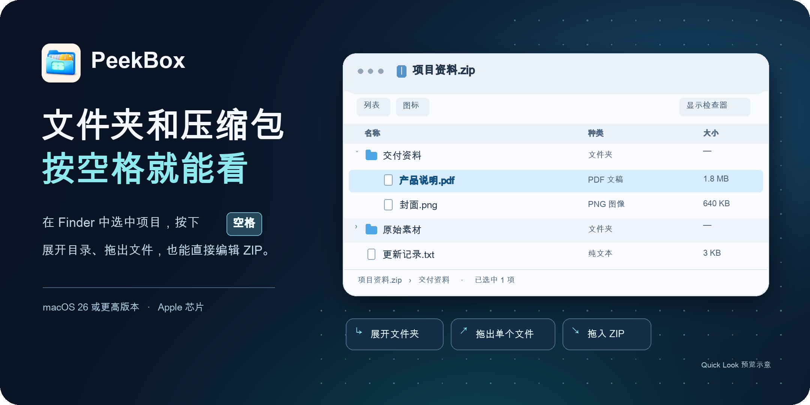

**简体中文** · [English](README.en.md)



# PeekBox

PeekBox 是一款面向 Apple 芯片 Mac 的 Quick Look 工具。在 Finder 中选中文件夹或压缩包，按空格就能展开目录、查看条目并操作文件。只需要压缩包里的几份文件时，选中它们拖到目标位置即可。

[下载安装包](https://github.com/davie-01/Peekbox/releases/latest) · [从源码构建](#从源码构建) · [设计文档](docs/DESIGN.md) · [第三方许可](THIRD-PARTY-LICENSES.md)

## 可以做什么

| 场景 | 操作 |
| --- | --- |
| 浏览文件夹 | 展开目录和其中的压缩包，在列表、图标和分栏视图之间切换，查看大小、类型和日期等信息。 |
| 浏览压缩包 | 查看 ZIP、7z、RAR、TAR、tar.gz、tar.bz2、tar.xz，以及系统可识别的 gzip、bzip2、xz 文件。 |
| 只解压所选文件 | 在预览中选中一个或多个条目，拖到 Finder 文件夹或桌面。读取加密内容时，按提示输入密码。 |
| 修改 ZIP | 把文件或文件夹从 Finder 拖入 ZIP 根目录或子目录，也可以新建目录、重命名或删除条目。遇到同名项目时按界面提示处理。 |
| 打开和检查文件 | 从工具栏或右键菜单打开、拷贝、复制路径、查看信息或在 Finder 中定位。支持的操作随项目类型和权限变化。检查器可显示支持类型的内容。 |

ZIP 写入适用于内置磁盘上可写的常规单卷 ZIP。网络卷、外置卷、iCloud 文件及检测到签名的归档不提供 ZIP 写入。加密 ZIP 不支持拖入或新建目录，但可以重命名和删除条目。7z、RAR、TAR 等格式可浏览和提取。

分卷归档需要把各卷放在同一个目录：

| 分卷形式 | 入口卷 | 打开方式 |
| --- | --- | --- |
| 分卷 ZIP（`.zip` + `.z01` …） | `.zip` | 选中入口卷按空格，或在所在文件夹的预览中展开 |
| RAR 分卷（`.part01.rar` …） | `.part01.rar` | 同上 |
| 7z 等编号分卷（`.001` …） | `.001` | 只能在所在文件夹的预览中展开（系统不把 `.001` 识别为压缩包） |

加密的分卷包同样支持，按提示输入密码即可。

## 安装

**系统要求**：Apple 芯片（M 系列，arm64），macOS 26.0 或更高版本。

1. 打开 [GitHub Releases](https://github.com/davie-01/Peekbox/releases/latest)，下载 Assets 中的 `PeekBox-<版本>.zip`。
2. 解压 ZIP，将 `PeekBox.app` 拖到「应用程序」，然后打开一次。
3. 在 PeekBox 首页查看「文件夹预览」「压缩包预览」「后台服务」的状态，三项都显示「已启用」即可使用。后台服务在首次打开时自动注册，系统会提示「已添加后台项目」；它负责打开、拷贝、提取和写入 ZIP，只在需要时运行。如有扩展未启用，按旁边的按钮到「系统设置 → 通用 → 登录项与扩展 → 快速查看」打开。
4. 回到 Finder，选中文件夹或压缩包并按空格。
5. 如果首页「其他预览扩展」一栏列出了别的应用（如 Folder Preview Pro），说明它也在处理同类文件，系统会在两者之间任选其一，PeekBox 可能不生效。在「快速查看」里停用它即可。

### macOS 提示无法验证开发者

当前发布包未经过 Apple 公证。确认安装包来自本项目的 GitHub Releases 后，先尝试打开一次，再到「系统设置 → 隐私与安全性」，在「安全性」中点「仍要打开」，确认后重新打开应用。 [Apple 安装说明](https://support.apple.com/102445)

如果系统没有显示这个选项，而你已确认安装包来源，可以只移除 `PeekBox.app` 的下载隔离属性。以下命令假设应用已移到「应用程序」。

```bash
# 仅移除这个应用包及其内容的下载隔离属性。
xattr -dr com.apple.quarantine "/Applications/PeekBox.app"

# 再次打开应用，进入首次运行引导。
open "/Applications/PeekBox.app"
```

移除隔离属性不会给应用添加公证，也无法修复损坏的包或无效的代码签名。若系统明确提示应用可能危害电脑，请重新核对下载来源和发行文件。

## 使用

1. **打开预览**。在 Finder 中选中文件夹或压缩包，按空格。点击箭头展开子目录，双击文件夹可进入下一级。
2. **提取文件**。从归档预览中拖出选中的条目，放到桌面或 Finder 目录。若应用要求输入密码，先解锁，再重新拖动。
3. **写入 ZIP**。把 Finder 文件拖到 ZIP 预览的空白处或目标目录。右键可查看当前选中位置支持的新建目录、重命名和删除操作。写入期间会显示进度，预览窗口仍可继续浏览；关闭预览不会中断写入，重新打开后内容会自动刷新。默认情况下，重命名、删除或替换条目前的旧版本以「xxx（修改前）.zip」移到废纸篓，可在废纸篓中「放回原处」。
4. **调整界面**。用预览工具栏切换视图或打开检查器。在主应用中可管理列、图标大小、隐藏文件、归档大小限制和临时缓存。

文件浏览和解压在本机执行，PeekBox 不收集任何数据。只有在应用内点「检查更新」时，Sparkle 才会访问 GitHub 上的更新源；有新版本时，提示中会列出本次更新的内容。

## 从源码构建

准备 Apple 芯片 Mac、完整的 Xcode（含 macOS 26 或更新的 SDK，以及 Icon Composer 资源编译支持）、Git、CMake 和 XcodeGen。以下示例使用 Homebrew 安装构建工具。

```bash
# 安装工程生成工具和 libzip 的构建工具。
brew install xcodegen cmake

# 克隆项目并进入源码目录。
git clone https://github.com/davie-01/Peekbox.git
cd Peekbox

# 下载固定版本的第三方源码，并构建 arm64 XCFramework。
./Scripts/build-libzip.sh
./Scripts/build-xadmaster.sh

# 从 project.yml 生成 Xcode 工程，并修正 AppIcon.icon 的文件类型。
./Scripts/generate-project.sh

# 打开生成的工程，在 Xcode 中检查各目标的签名设置。
open PeekBox.xcodeproj
```

仓库预设了维护者的开发团队。使用自己的证书构建前，请在 `project.yml` 中配置自己的团队和签名标识，并将各目标的 App Group、Mach 服务名、LaunchAgent 和 `PeekShared.teamID` 同步到同一个团队前缀。否则即使应用能编译，Quick Look 扩展也可能无法调用后台服务。具体位置见 [签名与进程间通信](docs/DESIGN.md#签名与进程间通信)。

完成签名配置后，可选用仓库脚本构建并安装 Debug 版。脚本会替换 `/Applications/PeekBox.app`，并刷新 PeekBox 的扩展注册。请先保存该位置已有的应用副本。

```bash
# 构建并安装 Debug 版到「应用程序」，刷新 Quick Look 扩展注册。
./Scripts/install.sh

# 在第三方框架构建完成后，运行 PeekCore 测试。
swift test --package-path Packages/PeekCore
```

部分格式测试需要 `7zz`（`brew install sevenzip`），找不到时这些用例自动跳过。安装发行版不需要 Xcode、XcodeGen、CMake 或 `7zz`。

## 反馈与许可

反馈问题时，请提供 macOS 版本、PeekBox 版本、文件格式、复现步骤，以及是从 Finder 单独预览还是在文件夹预览中展开。涉及私有或加密内容时，可提供一个去掉敏感数据的复现样本。 [提交问题](https://github.com/davie-01/Peekbox/issues)

PeekBox 自有代码采用 [GNU 通用公共许可证第 3 版](LICENSE)（GPL-3.0-only）。第三方组件适用各自的许可，详见 [第三方许可](THIRD-PARTY-LICENSES.md)。这些许可原文也随应用附带，可在 PeekBox「关于」页点「显示许可文件」查看。
