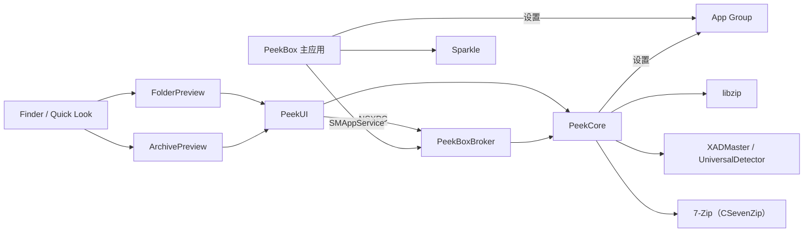

# PeekBox 设计文档

本文说明当前实现、运行时边界、构建与发行方式，内容以当前源码为准。

## 架构



| 模块 | 职责 |
| --- | --- |
| `App/` | SwiftUI 设置窗口：首次运行引导、扩展与后台服务状态、其他预览扩展冲突提示、隐私授权检查、缓存维护、Sparkle 更新入口。 |
| `Extensions/FolderPreview/` | 由系统 Quick Look 加载，接收 Finder 传入的目录或卷，展示目录与可展开的归档。 |
| `Extensions/ArchivePreview/` | 声明支持的归档与磁盘镜像类型，接收文件 URL，用同一套浏览组件展示。 |
| `Packages/PeekUI/` | AppKit 预览界面：列表、图标、分栏三种视图，选择、检查器、拖放、密码输入和弹出框。 |
| `Packages/PeekCore/` | 条目模型、数据源、归档树、读取引擎、文件名编码、ZIP 编辑事务、从归档拷到文件夹、隔离属性继承、共享设置与 Broker 协议。 |
| `Broker/` | 用户会话中按需启动的后台服务。承接 XPC 调用，完成扩展在沙盒内做不到的文件操作，并显示写入进度、冲突与重命名面板。 |

### Quick Look 环境的约束

预览界面运行在 Finder 的 Quick Look 窗口中，有几条系统层面的限制，决定了很多交互设计：

- **收不到键盘事件**。方向键、字母键和空格都由 Finder 处理，预览内的所有操作都通过鼠标完成；需要输入文字（重命名、新建目录）时由后台服务弹出面板。
- **只用单层菜单**。Quick Look 中展开子菜单后点击会失效，多选项设置放在弹出面板里。
- **窗口尺寸由系统按项目记忆**。预览不主动修改窗口大小，否则同一项目再次打开时视图与窗口尺寸不一致，整个预览无法点击。
- **扩展在沙盒中只能读被预览的项目**。打开、拷贝、移到废纸篓、写入 ZIP，以及读取同目录的其他分卷，都交给后台服务完成。

### 浏览与提取

- 两个扩展复用 `BrowserViewController`。`FolderSource` 与 `ArchiveSource` 实现 `EntrySource`，预览层通过统一的条目模型浏览目录和归档，只列举当前展开的层级。
- ZIP 优先交给 libzip，只读中央目录，不整包读入；磁盘镜像交给 7-Zip；其他格式和 libzip 打不开的 ZIP 交给 XADMaster。没有 UTF-8 标记的旧 ZIP 文件名由 UniversalDetector 识别编码（如 GBK）。
- 包（`.app`、`.bundle` 等，按扩展名判断）在归档中是目录，按 Finder 的习惯作为一个整体显示：不展开，显示总大小、种类和包内 `.icns` 图标。双击时提取后交给系统打开。
- 提取目录时，引擎能读出目标的符号链接按原样重建（App 包内的 framework 依赖它们），并在全部文件写完后才创建；上级路径经由已建的符号链接指向目标之外时跳过，文件不会写到目标目录以外。
- 拖出通过 `NSFilePromiseProvider` 交付，目标接收后才提取所选条目。打开、拷贝等操作由后台服务把条目提取到 `~/Library/Caches/com.mars.PeekBox/Materialized/`，再交给 Finder 或目标应用；同一条目未改动时复用已提取的副本，按保留时长回收。
- **分卷归档**：在文件夹预览中，扩展能读到同目录的各卷，直接读取。单独预览入口卷时，扩展先检查能否打开第二卷，打不开就改用 `BrokerArchiveReader`：由后台服务解析目录树后传回，提取时由后台服务把条目直接写到目标位置。密码错误、需要密码等错误原样传回，照常弹出密码框。
- **隔离属性**：拖出、打开、拷贝及拷进文件夹的条目都继承压缩包的 `com.apple.quarantine`（`Quarantine`），与"归档实用工具"解压、Finder 从挂载的镜像拷出一致，下载来的 App 首次打开时仍经过 Gatekeeper。后台服务按原样复制属性值；沙盒中的扩展不能直接写这个属性（`setxattr` 返回 EPERM），改用系统的 Quarantine API，事件 ID 与压缩包相同，来源程序记为扩展本身。压缩包本身未被隔离时不添加。
- 正在显示的压缩包由 kqueue 监视。文件被替换（写入提交是原子替换）、删除或被其他程序改写后，预览按文件身份（设备号、inode、大小、修改时间）判断，自动重新读取；本窗口发起的写入已刷新过时不重复读取。

### 磁盘镜像

- 由 7-Zip 读取（`SevenZipArchive`，桥接层在 `Packages/PeekCore/SevenZipBridge/`）。按扩展名或签名（DMG 的 `koly` 尾部、ISO 9660 / UDF 的卷描述符）识别，7-Zip 打不开的 ISO 再交给 XADMaster。
- 桥接层按固定顺序尝试文件系统与容器格式：文件系统在前；UDF 在 ISO 9660 前（ISO 9660 部分放不下 4 GB 以上的文件）；MBR 没有签名、FAT 与 NTFS 引导扇区也以 `55 AA` 结尾，最后尝试。容器（DMG、GPT、MBR、APM、VHD/VHDX、VMDK、QCOW、VDI）的每个分区再当作新的流打开，直到遇到文件系统；小于 64 KB 的分区（保护性 MBR、GPT 头）不尝试。
- 只有一个卷时内容直接放在根目录，卷名显示在标题栏；多个卷时每个卷占一个顶层目录。HFS+ 的卷根目录层与私有目录（硬链接数据）不显示；7-Zip 显示为 `[]` 的空格名称还原为空格（安装盘中指向 /Applications 的替身）。
- 认不出文件系统的分区以"分区 N（文件系统）.img"列出，拖出后可在 Finder 中挂载；按签名识别 exFAT、BitLocker、LUKS、XFS、Btrfs 等。加密 DMG 暂不支持，明确提示。
- 提取文件时写回 HFS+ / APFS 中的扩展属性（非 Mach-O 文件的代码签名 `com.apple.cs.*`、资源分叉等），与 Finder 从挂载的镜像拷贝一致；透明压缩的 `com.apple.decmpfs` 及其资源分叉、APFS 内部的 `com.apple.fs.symlink` 不写回。
- 在预览内把条目拖到指向本机真实文件夹的替身上（如安装盘里的"应用程序"），由后台服务拷入（`ArchiveCopier`）：先提取到目标文件夹内的隐藏暂存目录、继承隔离属性，再逐个移入；同名时询问替换 / 跳过 / 保留两者，替换的旧项目移到废纸篓；中途失败或取消时删除暂存目录。
- 7-Zip 只编译读取相关的格式与解码器，不包含受 unRAR 许可限制的 RAR 解码器。对 7-Zip 的修改放在 `SevenZipBridge/patches/`，构建脚本每次从固定版本的原始源码重新打补丁：目前只有 UDF 接受符号链接条目（原版遇到符号链接会拒绝整个镜像）。

### ZIP 写入

写入入口包括拖入、新建目录、重命名和删除。预览负责识别目标、发起请求；后台服务按归档串行执行写事务，显示进度与冲突面板；`ZipEditor` 负责事务本身。

1. 检查归档位置（本机内置磁盘、非 iCloud）、写权限、结构（排除分卷与重复路径）、签名痕迹和可用空间，并记录原归档的文件身份。
2. 在同目录用 APFS 克隆复制出工作副本，通过 libzip 修改。输入文件先流式暂存并计算 CRC，内存占用不随文件大小增长。
3. 重新打开产物并校验条目与内容。替换前再次比对原归档身份，原归档被外部修改时放弃提交。
4. 原子替换原归档。按设置把旧版本以「xxx（修改前）.zip」移到废纸篓；后台服务启动时清理异常中断留下的工作文件。

写入面板分为两个：进度面板永不取得键盘焦点，写入期间预览窗口仍可操作；同名冲突对话框取得焦点（回车替换、Esc 取消），处理完关闭，焦点交还预览窗口。关闭预览不会终止写入。

### 后台服务的生命周期

- 主应用首次打开时用 `SMAppService` 注册 LaunchAgent。配置中没有 `RunAtLoad` 和 `KeepAlive`，只在扩展或主应用连接其 Mach 服务时由 launchd 拉起，开机不自动运行。
- 客户端没有进行中的请求 2 秒后主动断开连接。系统会长期缓存预览扩展进程，一直挂着连接会让后台服务跟着常驻。所有连接断开且没有进行中的任务时，后台服务 30 秒后退出。
- 应用更新会整体替换 `PeekBox.app`。后台服务启动时记下自身可执行文件的身份，发现已被替换就不再接受新连接，手头任务完成后立即退出，下一次请求由 launchd 拉起新版本。旧进程若继续服务，系统会按磁盘上的新签名核对它，导致隐私授权失效、客户端拒收回复。

### 签名与进程间通信

- Quick Look 扩展在系统宿主中运行并受沙盒约束。扩展通过命名 `NSXPCConnection` 调用 `PeekBoxBroker`，双方都用代码签名要求校验对方属于同一开发团队。
- 主应用、扩展和后台服务通过 App Group 共享设置文件（`settings.plist`）。`SettingsStore` 用文件锁保护跨进程的读改写；沙盒扩展对容器只有读权限，写入交给后台服务代办。
- 发行构建把后台服务放在 `PeekBox.app/Contents/Helpers/PeekBoxBroker.app`。PeekCore 与 PeekUI 是动态框架，与 XADMaster、UniversalDetector、CSevenZip 一样只嵌入主应用 `Contents/Frameworks/` 一份；两个扩展与后台服务不自带框架，经 rpath 加载这一份。
- 使用免费开发团队签名，不嵌入描述文件；当前发行包未经 Apple 公证。
- 更换开发团队时，以 `project.yml` 为工程配置源，核对主应用、扩展和后台服务的 entitlements、`App/LaunchAgents/com.mars.PeekBox.Broker.plist`，以及 `Packages/PeekCore/Sources/PeekCore/PeekShared.swift`。团队前缀、App Group、Mach 服务注册名与查询名必须一致。重新生成工程后，实测两个扩展以及主应用到后台服务的连接。
- Sparkle 的 EdDSA 更新签名与 macOS 代码签名相互独立。复用已有更新渠道时，要保留受现有安装信任的 Sparkle 私钥；为 fork 建立自己的更新渠道时，同步配置公钥（`SPARKLE_PUBLIC_KEY`）和 `SUFeedURL`。

## 技术选型

| 技术 | 在项目中的用途 |
| --- | --- |
| Swift 6、AppKit、SwiftUI | Swift 组织共享逻辑与并发。AppKit 提供 Quick Look 内的原生表格、图标和拖放。SwiftUI 用于设置窗口。 |
| Quick Look、NSXPC、SMAppService | 复用 Finder 的空格键入口，把文件操作委托给用户会话中的后台服务，由系统维护注册状态。 |
| libzip、XADMaster、UniversalDetector、7-Zip | libzip 处理 ZIP 读取和写入。XADMaster 提供其他格式与分卷读取。UniversalDetector 识别旧编码文件名。7-Zip 读取磁盘镜像与文件系统。 |
| XcodeGen、Swift Package Manager、CMake | `project.yml` 生成应用与扩展工程，SwiftPM 管理共享模块和 Sparkle，CMake 构建固定版本的 libzip。 |
| Sparkle 2 | 只在用户点「检查更新」时读取 GitHub Releases 上的 appcast，校验 EdDSA 签名后安装，并显示每个版本的更新说明。 |

目标平台为 macOS 26 及以上、Apple 芯片（arm64）。版本号由 `MARKETING_VERSION` 管理，Sparkle 比较的构建号来自 `CURRENT_PROJECT_VERSION`。

## 仓库结构

```text
PeekBox/
├── README.md                     项目介绍、安装、使用与源码构建（中文）
├── README.en.md                  同上（英文）
├── THIRD-PARTY-LICENSES.md       第三方组件与许可说明
├── LICENSE                       PeekBox 自有代码的许可（GPL-3.0-only）
├── licenses/                     第三方许可原文与版权声明
├── assets/                       README 用图
├── project.yml                   XcodeGen 工程配置（目标、签名、版本号、Info.plist 键、依赖版本）
├── App/                          主应用
│   ├── PeekBoxApp.swift          入口，启动时校正后台服务注册
│   ├── SettingsView.swift        设置窗口各页面
│   ├── SettingsModel.swift       扩展 / 后台服务状态、冲突检测、授权检查、缓存维护
│   ├── BrokerRegistration.swift  后台服务位置变化后重新注册
│   ├── Updater.swift             Sparkle 更新入口
│   ├── LaunchAgents/             后台服务的 LaunchAgent 配置
│   └── AppIcon.icon/             Icon Composer 图标
├── Extensions/
│   ├── FolderPreview/            文件夹与卷的 Quick Look 扩展
│   └── ArchivePreview/           压缩包的 Quick Look 扩展
├── Broker/                       后台服务
│   ├── main.swift                XPC 服务、生命周期、文件操作与 ZIP 写入调度
│   ├── MaterializeCache.swift    读取器与已提取文件的复用
│   ├── ArchiveWritePanel.swift   写入进度与同名冲突面板
│   ├── RenamePanel.swift         重命名 / 新建目录输入面板
│   └── DialogDemo.swift          开发用：单独弹出面板检查样式
├── Packages/
│   ├── PeekCore/                 核心逻辑（不依赖界面）
│   │   ├── Sources/PeekCore/
│   │   │   ├── Entry.swift / FolderSource.swift / ArchiveSource.swift   条目模型与数据源
│   │   │   ├── ArchiveTree.swift / ZipArchive.swift / XADArchive.swift / SevenZipArchive.swift   归档树与读取引擎
│   │   │   ├── ArchiveCopier.swift / Quarantine.swift                   从归档拷到文件夹、隔离属性继承
│   │   │   ├── BrokerArchiveReader.swift / VolumeInfo.swift             分卷识别与后台服务代读
│   │   │   ├── ZipEditor.swift / ZipWriteWorkspace.swift / ZipWriteControl.swift   ZIP 写入事务
│   │   │   ├── NameEncoding.swift                                       旧编码文件名解码
│   │   │   ├── Broker.swift / PeekShared.swift                          XPC 协议、客户端与共享标识
│   │   │   ├── SettingsStore.swift / PeekPreferences.swift              共享设置
│   │   │   └── MaterializedCache.swift / FileIdentity.swift / …         提取缓存与工具
│   │   ├── SevenZipBridge/       7-Zip 的 C 桥接层与对 7-Zip 的补丁（patches/），由 build-7zip.sh 编译
│   │   ├── Tests/PeekCoreTests/  单元测试与样本（Fixtures/）
│   │   └── Vendor/               第三方 XCFramework（由脚本生成，不纳入 git）
│   └── PeekUI/                   预览界面
│       └── Sources/PeekUI/
│           ├── BrowserViewController.swift          浏览视图主体
│           ├── BrowserViewController+*.swift        操作、图标视图、检查器、密码、快速设置、ZIP 写入、文件监视、条目图标、拷到文件夹
│           ├── ArchivePromiseDelegate.swift         拖出（File Promise）
│           ├── InspectorView.swift / InspectorLoader.swift   检查器
│           └── DialogKit.swift                      弹出框与面板组件
├── Scripts/
│   ├── build-libzip.sh           下载固定版本 libzip、校验 SHA-256、构建 XCFramework
│   ├── build-xadmaster.sh        按固定提交构建 XADMaster 与 UniversalDetector
│   ├── build-7zip.sh             按固定提交编译 7-Zip 的读取部分与桥接层，打补丁，构建 CSevenZip 动态框架
│   ├── generate-project.sh       生成 Xcode 工程并修正图标文件类型
│   ├── install.sh                构建 Debug 版并安装到「应用程序」
│   ├── release.sh                构建 Release、交付检查、打包并生成 appcast
│   ├── sync-strings.sh           同步界面文案并套用英文翻译
│   ├── apply-translations.py / translations-en.json   英文翻译
│   └── make-app-icon.swift       从图标母版生成 AppIcon.icon
└── docs/
    ├── DESIGN.md                 本文档
    └── 发布说明/<版本号>.md       各版本更新说明（嵌入 appcast）
```

构建产物位于 `build/`，生成的 `PeekBox.xcodeproj` 与 `Packages/PeekCore/Vendor/` 都不纳入 git，可由脚本重新生成。

## 构建、验证与发布

- `Scripts/generate-project.sh` 从 `project.yml` 生成工程并修正 Icon Composer 资源类型。升级依赖时，核对 `build-libzip.sh` 的 SHA-256、`build-xadmaster.sh` 与 `build-7zip.sh` 的固定提交（7-Zip 升级后确认补丁仍能应用）和 `project.yml` 中的 Sparkle 版本，并同步更新 [第三方许可](../THIRD-PARTY-LICENSES.md)。
- `swift test --package-path Packages/PeekCore` 运行核心测试，覆盖归档树、格式矩阵与编码、磁盘镜像（用 hdiutil 现场生成各种 DMG / ISO / UDF）、拷到文件夹与隔离属性、ZIP 写入与交叉校验、文件身份与一致性、分卷识别、设置并发写入和导入内存占用。Finder 实机回归应覆盖空格预览、滚动、拖出与拖入、DMG 中的 App 拖到"应用程序"替身、加密解锁、分卷、两个扩展的注册、后台服务按需启动与退出，以及其他预览扩展同时启用时的提示。
- 发布前在 `docs/发布说明/<版本号>.md` 写好更新说明，再运行 `Scripts/release.sh <版本号> <构建号>`。脚本构建 arm64 Release，检查签名、图标、后台服务、两个扩展，确认不含 Debug 产物和描述文件，然后打包 ZIP、把更新说明嵌入 appcast 并签名。
- 发布包要瘦身，Debug 版照常构建：`release.sh` 在签名前去除符号、链接时裁剪死代码、资源目录按体积编译，第三方动态框架在各自构建脚本中只保留导出符号。交付检查确认二进制不含调试符号、框架只有一份且各可执行文件的依赖都能按 rpath 找到。去除的调试信息存为 dSYM（`build/releases/<版本号>/PeekBox-<版本号>-dSYMs.zip`），留在本机用来符号化崩溃日志，不上传。构建号必须大于此前发布过的任何版本。
- 把 ZIP 和 appcast 上传到标签为 `v<版本号>` 的 GitHub Release 并设为 Latest；应用的更新地址（`SUFeedURL`）指向最新 Release 附带的 appcast。用旧版本实测更新，再检查应用、两个扩展和后台服务是否正常。
- 构建时把 `LICENSE`、`THIRD-PARTY-LICENSES.md` 与 `licenses/` 中的许可原文拷入 `PeekBox.app/Contents/Resources/Licenses/`，「关于」页可直接打开，`release.sh` 的交付检查会确认它们存在。发行时还需提供与二进制对应的源码，见 [第三方许可](../THIRD-PARTY-LICENSES.md)。
